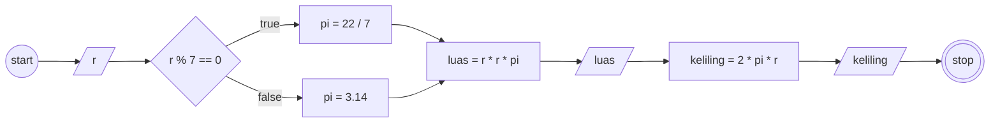

# Program: Menghitung Luas dan Keliling Lingkaran

## Cara Kerja Program

- Ada object lingkaran yang memiliki key rLingkaran dan 2 method (luasLingkaran dan kelilingLingkaran)
- Destrukturisasi nilai rLingkaran dari object lingkaran dengan alias r
- Inisialisasi variabel pi
- Apabila r habis dibagi 7, maka nilai pi menjadi 22/7
- Jika tidak maka nilai pi menjadi 3.14
- Inisialisasi variabel luas dengan nilai yang didapat dengan memanggil method luasLingkaran() dari object lingkaran
- Memberikan output luas
- Inisialisasi variabel keliling dengan nilai yang didapat dengan memanggil method kelilingLingkaran() dari object lingkaran
- Memberikan output keliling

## Flowchart

