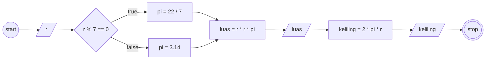

# Program: Menghitung Luas dan Keliling Lingkaran

## Cara Kerja Program

- Ada object lingkaran yang memiliki 2 key (r dan pi) dan 3 method (luasLingkaran, kelilingLingkaran, dan cekPi)
- Destrukturisasi nilai r dari object lingkaran ke dalam variabel r
- Menjalankan method lingkaran.cekPi untuk memperbarui nilai pi
- Inisialisasi variabel luas dengan nilai yang didapat dengan memanggil method lingkaran.luasLingkaran()
- Memberikan output luas
- Inisialisasi variabel keliling dengan nilai yang didapat dengan memanggil method lingkaran.kelilingLingkaran()
- Memberikan output keliling

## Flowchart

